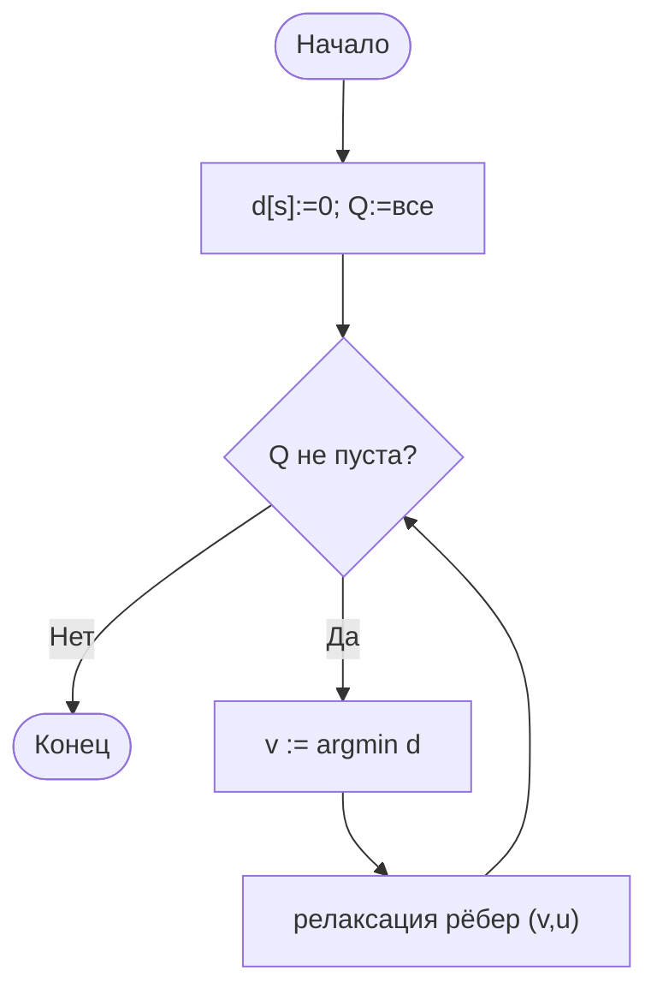
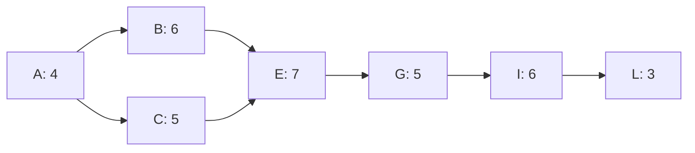

# Лабораторная работа № 10

**Алгоритмы поиска кратчайших путей и расчёта критического пути сетевого графика**

| | |
|---|---|
| **Дисциплина** | Основы алгоритмизации и программирования |
| **Направление** | 38.03.05 «Бизнес-информатика» |
| **Курс** | 2 |
| **Группа** | БИ 2-1 |
| **Выполнила** | Осипова Анна Алексеевна |
| **Вариант** | 17 |
| **Язык реализации** | Python 3.10+ |
| **Год** | 2026 |

---

## 1. Цель работы

Реализовать алгоритм Дейкстры в двух вариантах (линейный поиск и приоритетная очередь), сравнить на решётках k×k; рассчитать критический путь сетевого графика из 12 работ. Доп. К3 — зависимость времени от плотности графа.

---

## 2. Задание варианта 17

| Параметр | Значение |
|---|---|
| Графы для Дейкстры | Решётка k×k |
| Размеры | k = 20; 40; 80 (n = 400; 1600; 6400) |
| Веса рёбер | 1…25 |
| Число работ в проекте | 12 |
| Доп. задание | **К3** — время обеих реализаций от плотности |

---

## 3. Теоретическая часть

### 3.1. Алгоритм Дейкстры

Оценки d[v]; на каждом шаге — вершина с минимальным d среди непросмотренных; релаксация исходящих рёбер. Требуются **неотрицательные** веса.

| Реализация | Поиск min | Трудоёмкость |
|---|---|---|
| Массив | Θ(n) за шаг | Θ(n²) |
| Двоичная куча | O(log n) | O(m log n) |

### 3.2. Метод критического пути (CPM)

DAG работ. Прямой проход → ES, EF; обратный → LS, LF. Резерв R = LS − ES. Критический путь — работы с R = 0.

---

## 4. Блок-схема Дейкстры



---

## 5. Сетевой график (12 работ)



(зелёным выделен критический путь A→B→E→G→I→L)

---

## 6. Листинг (фрагменты)

```python
def dijkstra_array(adj, s):  # Θ(n²)
    dist = [INF] * n; used = [False] * n; dist[s] = 0
    for _ in range(n):
        v = argmin(dist among not used)
        used[v] = True
        for u, w in adj[v]:
            if dist[v] + w < dist[u]:
                dist[u] = dist[v] + w; parent[u] = v
    return dist, parent

def dijkstra_heap(adj, s):  # O(m log n)
    dist = [INF] * n; dist[s] = 0
    heap = [(0, s)]
    while heap:
        d, v = heappop(heap)
        if d > dist[v]: continue
        for u, w in adj[v]:
            if d + w < dist[u]:
                dist[u] = d + w; parent[u] = v
                heappush(heap, (dist[u], u))
    return dist, parent
```

---

## 7. Результаты

### 7.1. Дейкстра на решётках k×k

| k | n | m | Массив, с | Куча, с | Отношение | dist(end) |
|---:|---:|---:|---:|---:|---:|---:|
| 20 | 400 | 873 | 0,004 | 0,0002 | 18 | 275 |
| 40 | 1600 | 3607 | 0,077 | 0,0011 | 70 | 517 |
| 80 | 6400 | 14524 | 1,137 | 0,0050 | **229** | 1094 |

На разреженной решётке преимущество кучи растёт с n (до 229×).

### 7.2. К3: время vs плотность (n = 400)

| Плотность | m | Массив, с | Куча, с | Отношение |
|---:|---:|---:|---:|---:|
| 1% | 1596 | 0,004 | 0,0003 | 14 |
| 5% | 7980 | 0,004 | 0,0007 | 5,5 |
| 10% | 15960 | 0,005 | 0,0016 | 3,3 |
| 20% | 31920 | 0,006 | 0,0025 | 2,4 |
| 35% | 55860 | 0,010 | 0,0043 | 2,2 |
| 50% | 79800 | 0,013 | 0,0065 | 2,0 |

Куча выгоднее на всех плотностях; разрыв сокращается с ростом m, но не исчезает (при 50% ещё ~2×).

### 7.3. Критический путь

| Работа | t | ES | EF | LS | LF | R | Крит. |
|---|---:|---:|---:|---:|---:|---:|---|
| A | 4 | 0 | 4 | 0 | 4 | 0 | да |
| B | 6 | 4 | 10 | 4 | 10 | 0 | да |
| C | 5 | 4 | 9 | 5 | 10 | 1 | |
| D | 3 | 10 | 13 | 14 | 17 | 4 | |
| E | 7 | 10 | 17 | 10 | 17 | 0 | да |
| F | 4 | 9 | 13 | 17 | 21 | 8 | |
| G | 5 | 17 | 22 | 17 | 22 | 0 | да |
| H | 3 | 17 | 20 | 21 | 24 | 4 | |
| I | 6 | 22 | 28 | 22 | 28 | 0 | да |
| J | 2 | 22 | 24 | 26 | 28 | 4 | |
| K | 4 | 20 | 24 | 24 | 28 | 4 | |
| L | 3 | 28 | 31 | 28 | 31 | 0 | да |

**Длительность проекта: 31 день. Критический путь: A → B → E → G → I → L.**

---

## 8. Выводы

1. На решётках (разреженных) куча быстрее массива в 18–229 раз; разрыв растёт с n.
2. К3: при росте плотности преимущество кучи сокращается (14× → 2×), но куча остаётся быстрее.
3. Обе реализации дают одинаковые расстояния; путь восстанавливается по parent.
4. CPM за Θ(n+m): критические работы (R=0) определяют срок проекта.
5. Сокращение срока возможно только за счёт работ критического пути.

---

## 9. Контрольные вопросы

1. Кратчайший путь: min сумма весов; подпуть кратчайшего — кратчайший.
2. Релаксация: если d[v]+w < d[u], обновить d[u] и parent.
3. Отрицательные веса нарушают «окончательность» выбранной вершины.
4. Массив — плотные; куча — разреженные.
5. Беллман–Форд: O(nm), допускает отрицательные (без циклов).
6. Топсорт — порядок на DAG; каждое ребро вперёд.
7. Цикл: в результате топсорта меньше n вершин.
8. ES = max EF предков; LF = min LS потомков.
9. R = LS−ES; у критических R=0.
10. Некритическая работа имеет запас — её удлинение (в пределах R) не меняет T.

---

## 10. Литература

1. Кормен Т. и др. Алгоритмы: построение и анализ. — Гл. 22, 24.
2. Седжвик Р., Уэйн К. Алгоритмы на Java. — Гл. 4.4.
3. PMBOK Guide. — Project Management Institute.
4. docs.python.org — heapq

---

*Лабораторная работа № 10 • Осипова Анна Алексеевна • Вариант 17 • 2026*
