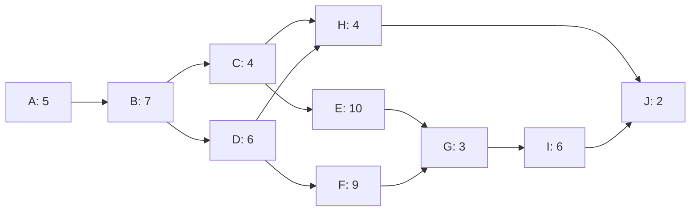
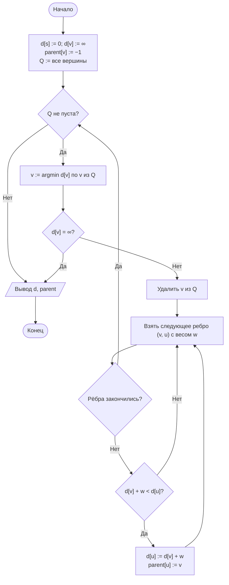

# Лабораторная работа № 10

## Алгоритмы поиска кратчайших путей и расчёта критического пути сетевого графика

**Дисциплина:** Теория алгоритмов
**Направление подготовки:** 38.03.05 «Бизнес-информатика»
**Курс:** 2
**Объём:** 4 академических часа
**Язык реализации:** Python 3.10+
**Предварительные требования:** ЛР № 9 (представление графов, обходы)

---

## 1. Цель и задачи работы

**Цель работы:** изучить алгоритмы оптимизации на взвешенных графах, реализовать алгоритм Дейкстры в двух вариантах реализации и применить топологическую сортировку к расчёту календарного плана проекта методом критического пути.

**Задачи:**

1. Изучить постановку задачи о кратчайших путях и условия применимости алгоритма Дейкстры.
2. Реализовать алгоритм Дейкстры с линейным поиском минимума и с приоритетной очередью, сопоставить их трудоёмкость экспериментально.
3. Восстановить не только длины, но и сами кратчайшие пути.
4. Реализовать топологическую сортировку ориентированного ациклического графа.
5. Рассчитать ранние и поздние сроки работ, резервы времени и критический путь сетевого графика проекта.

---

## 2. Теоретическая часть

### 2.1. Задача о кратчайших путях

Дан взвешенный ориентированный граф $G = (V, E)$ с весовой функцией $w: E \to \mathbb{R}$. Длина пути равна сумме весов входящих в него рёбер. Требуется найти путь минимальной длины из вершины $s$ в вершину $t$ либо из $s$ во все остальные вершины.

**Свойство оптимальной подструктуры.** Любой подпуть кратчайшего пути сам является кратчайшим. Именно это свойство лежит в основе всех рассматриваемых алгоритмов.

| Задача | Алгоритм | Трудоёмкость | Ограничение |
|---|---|---|---|
| Из одной вершины, веса $\ge 0$ | Дейкстры | $\Theta(n^2)$ или $O(m \log n)$ | Неотрицательные веса |
| Из одной вершины, любые веса | Беллмана — Форда | $\Theta(nm)$ | Отсутствие отрицательных циклов |
| Между всеми парами | Флойда — Уоршелла | $\Theta(n^3)$ | Отсутствие отрицательных циклов |
| Невзвешенный граф | BFS | $\Theta(n + m)$ | Все веса равны |

### 2.2. Алгоритм Дейкстры

Поддерживается массив оценок $d[v]$ — длина найденного на текущий момент кратчайшего пути из $s$ в $v$. Изначально $d[s] = 0$, остальные равны $\infty$.

На каждом шаге:

1. среди непросмотренных вершин выбирается вершина $v$ с наименьшим $d[v]$ и помечается как просмотренная;
2. выполняется **релаксация** всех исходящих рёбер: если $d[v] + w(v, u) < d[u]$, то $d[u]$ обновляется, а предком $u$ становится $v$.

```
DIJKSTRA(G, s)
1  d[s] = 0; d[v] = ∞ для остальных v
2  Q = все вершины
3  пока Q не пуста
4      v = вершина из Q с минимальным d[v]
5      удалить v из Q
6      для каждого ребра (v, u) с весом w
7          если d[v] + w < d[u]
8              d[u] = d[v] + w;  parent[u] = v
```

**Требование неотрицательности весов.** Алгоритм считает, что вершина с минимальной оценкой уже получила окончательное значение. При наличии отрицательного ребра это предположение нарушается, и результат может оказаться неверным.

**Две реализации:**

| Реализация | Поиск минимума | Общая трудоёмкость | Когда выгодна |
|---|---|---|---|
| Линейный поиск по массиву | $\Theta(n)$ за шаг | $\Theta(n^2)$ | Плотные графы, $m \approx n^2$ |
| Двоичная куча (приоритетная очередь) | $O(\log n)$ за операцию | $O(m \log n)$ | Разреженные графы |

Для разреженного графа с $m = 3n$ при $n = 10^4$ первая оценка даёт $10^8$ операций, вторая — около $4 \cdot 10^5$.

### 2.3. Топологическая сортировка

**Ориентированный ациклический граф** (directed acyclic graph, DAG) — граф без циклов. Топологическая сортировка — такое упорядочение вершин, при котором каждое ребро ведёт от более ранней вершины к более поздней.

Алгоритм Кана использует входящие степени вершин:

1. вычислить $\deg^{-}(v)$ для всех вершин;
2. поместить в очередь вершины с нулевой входящей степенью;
3. извлекая вершину, добавлять её в результат и уменьшать степени её потомков; при обнулении степени помещать потомка в очередь.

Трудоёмкость $\Theta(n + m)$. Если результат содержит меньше $n$ вершин, граф содержит цикл. Для сетевого графика проекта это означает ошибку: работа зависит сама от себя.

### 2.4. Метод критического пути

Сетевой график проекта — это DAG, вершины которого соответствуют работам, а дуги — отношениям предшествования. Каждой работе $i$ сопоставлена длительность $t_i$.

**Прямой проход** (в топологическом порядке) даёт ранние сроки:

$$ES_i = \max_{j \in \text{Pred}(i)} EF_j, \qquad EF_i = ES_i + t_i,$$

где $ES$ — ранний старт, $EF$ — раннее окончание. Для работ без предшественников $ES_i = 0$.

Длительность проекта равна $T = \max_i EF_i$.

**Обратный проход** (в обратном топологическом порядке) даёт поздние сроки:

$$LF_i = \min_{j \in \text{Succ}(i)} LS_j, \qquad LS_i = LF_i - t_i,$$

причём для работ без последователей $LF_i = T$.

**Полный резерв времени:**

$$R_i = LS_i - ES_i = LF_i - EF_i.$$

**Критический путь** образуют работы с нулевым резервом. Задержка любой из них увеличивает срок всего проекта; сокращение длительности проекта возможно только за счёт работ критического пути.

Трудоёмкость метода составляет $\Theta(n + m)$, то есть расчёт выполняется за один проход по графику в каждом направлении. Метод разработан в конце 1950-х годов (CPM, critical path method) и лежит в основе календарного планирования [4, 5].

---

## 3. Порядок выполнения работы

1. Изучить теоретическую часть.
2. Реализовать алгоритм Дейкстры в двух вариантах: с линейным поиском минимума и с приоритетной очередью (`heapq`).
3. Проверить корректность на малом графе (6–8 вершин), выполнив расчёт также вручную.
4. Измерить время обеих реализаций на графах различного размера и плотности согласно варианту (табл. 1).
5. Реализовать восстановление кратчайшего пути по массиву предков.
6. Реализовать топологическую сортировку и расчёт критического пути для сетевого графика из табл. 2 (или сгенерированного согласно варианту).
7. Вывести таблицу работ с полями $t_i$, $ES$, $EF$, $LS$, $LF$, $R$ и выделить критический путь.
8. Выполнить дополнительное задание и оформить отчёт.

---

## 4. Варианты заданий

**Таблица 1. Исходные данные**

| № | Графы для Дейкстры | Размеры $n$ | Веса рёбер | Число работ в проекте | Доп. |
|---|---|---|---|---|---|
| 0 | Разреженный ($m \approx 4n$) и плотный (20 %) | 200; 500; 1000; 2000 | 1…100 | 10 | — |
| 1 | Разреженный ($m \approx 3n$) | 500; 1000; 5000 | 1…50 | 12 | К1 |
| 2 | Плотный (30 %) | 100; 300; 600; 1000 | 1…1000 | 10 | К2 |
| 3 | Решётка $k \times k$ | $k$ = 20; 40; 60 | 1…20 | 14 | К3 |
| 4 | Разреженный ($m \approx 5n$) | 1000; 2000; 4000 | 1…100 | 11 | К4 |
| 5 | Плотный (50 %) | 100; 200; 400; 800 | 1…10 | 12 | К5 |
| 6 | Разреженный и плотный | 200; 400; 800 | 1…500 | 13 | К6 |
| 7 | Решётка $k \times k$ | $k$ = 30; 50; 70 | 1…100 | 10 | К7 |
| 8 | Разреженный ($m \approx 3n$) | 1000; 5000; 10 000 | 1…100 | 15 | К1 |
| 9 | Плотный (25 %) | 100; 400; 700 | 1…1000 | 12 | К2 |
| 10 | Разреженный ($m \approx 6n$) | 500; 1000; 2000 | 1…30 | 10 | К3 |
| 11 | Решётка $k \times k$ | $k$ = 25; 45; 65 | 1…50 | 14 | К4 |
| 12 | Плотный (40 %) | 100; 300; 500 | 1…200 | 11 | К5 |
| 13 | Разреженный ($m \approx 4n$) | 2000; 4000; 8000 | 1…100 | 12 | К6 |
| 14 | Разреженный и плотный | 300; 600; 1200 | 1…80 | 13 | К7 |
| 15 | Плотный (35 %) | 100; 250; 500 | 1…60 | 10 | К1 |
| 16 | Разреженный ($m \approx 3n$) | 1000; 3000; 6000 | 1…150 | 15 | К2 |
| 17 | Решётка $k \times k$ | $k$ = 20; 40; 80 | 1…25 | 12 | К3 |
| 18 | Плотный (20 %) | 200; 500; 900 | 1…300 | 11 | К4 |
| 19 | Разреженный ($m \approx 5n$) | 1000; 2500; 5000 | 1…40 | 14 | К5 |
| 20 | Разреженный и плотный | 250; 500; 1000 | 1…120 | 10 | К6 |
| 21 | Решётка $k \times k$ | $k$ = 35; 55; 75 | 1…90 | 13 | К7 |
| 22 | Плотный (45 %) | 100; 200; 450 | 1…15 | 12 | К1 |
| 23 | Разреженный ($m \approx 4n$) | 1500; 3000; 6000 | 1…70 | 11 | К2 |
| 24 | Решётка $k \times k$ | $k$ = 30; 60; 90 | 1…100 | 15 | К3 |
| 25 | Плотный (30 %) | 150; 350; 650 | 1…500 | 10 | К4 |
| 26 | Разреженный ($m \approx 6n$) | 800; 1600; 3200 | 1…45 | 14 | К5 |
| 27 | Разреженный и плотный | 400; 800; 1600 | 1…100 | 12 | К6 |
| 28 | Плотный (50 %) | 100; 250; 400 | 1…20 | 13 | К7 |
| 29 | Разреженный ($m \approx 3n$) | 2000; 5000; 10 000 | 1…100 | 11 | К1 |
| 30 | Все типы графов | 200; 500; 1000 | 1…100 | 16 | К3 |

**Таблица 2. Сетевой график проекта (базовый набор, вариант 0)**

| Код | Наименование работы | Длительность, дн. | Предшественники |
|---|---|---|---|
| A | Сбор требований | 5 | — |
| B | Анализ бизнес-процессов | 7 | A |
| C | Проектирование базы данных | 4 | B |
| D | Проектирование интерфейса | 6 | B |
| E | Разработка серверной части | 10 | C |
| F | Разработка клиентской части | 9 | D |
| G | Интеграция модулей | 3 | E, F |
| H | Подготовка документации | 4 | C, D |
| I | Тестирование | 6 | G |
| J | Обучение пользователей | 2 | H, I |

В вариантах с другим числом работ студент дополняет или сокращает таблицу, сохраняя ацикличность и наличие не менее двух параллельных ветвей.

**Таблица 3. Дополнительные задания**

| Код | Содержание |
|---|---|
| К1 | Реализовать алгоритм **Беллмана — Форда** и сравнить его с Дейкстрой по времени. Показать на примере с отрицательным ребром, что Дейкстра даёт неверный результат |
| К2 | Найти кратчайшие пути **между всеми парами** вершин алгоритмом Флойда — Уоршелла. Сравнить с $n$-кратным запуском Дейкстры |
| К3 | Построить график зависимости времени обеих реализаций Дейкстры от плотности графа и найти точку, где реализация на куче теряет преимущество |
| К4 | Реализовать поиск не только длины, но и **числа** кратчайших путей между двумя вершинами |
| К5 | Провести анализ чувствительности проекта: увеличить длительность каждой работы на 1 день и определить, у каких работ это меняет срок проекта |
| К6 | Реализовать обнаружение цикла в сетевом графике и вывести сообщение о некорректности исходных данных. Проверить на графике с искусственно внесённым циклом |
| К7 | Построить диаграмму Ганта (например, средствами `matplotlib`) с выделением работ критического пути |

---

## 5. Требования к отчёту

1. Титульный лист.
2. Цель работы и задание варианта.
3. Описание алгоритмов с оценками трудоёмкости.
4. Изображение тестового графа и ручной расчёт кратчайших путей.
5. Изображение сетевого графика проекта.
6. Листинг программы.
7. Таблицы измерений и графики для двух реализаций Дейкстры.
8. Таблица расчёта сроков работ ($ES$, $EF$, $LS$, $LF$, $R$) с выделенным критическим путём.
9. Выводы.

---

## 6. Пример оформления отчёта (вариант 0)

### 6.1. Задание

Реализовать алгоритм Дейкстры в двух вариантах, сравнить их на разреженных ($m \approx 4n$) и плотных (20 % рёбер) графах при $n = 200, 500, 1000, 2000$. Рассчитать критический путь проекта из табл. 2.

### 6.2. Сетевой график проекта



### 6.3. Блок-схема алгоритма Дейкстры



### 6.4. Листинг программы

```python
"""
Лабораторная работа № 10. Вариант 0.
Алгоритм Дейкстры (две реализации) и расчёт критического пути проекта.
"""
import heapq
import random
import time
from collections import deque

INF = float("inf")


def dijkstra_array(adj, s):
    """Дейкстра с линейным поиском минимума. Трудоёмкость Θ(n²)."""
    n = len(adj)
    dist = [INF] * n
    parent = [-1] * n
    used = [False] * n
    dist[s] = 0
    for _ in range(n):
        v, best = -1, INF
        for i in range(n):                     # линейный поиск минимума
            if not used[i] and dist[i] < best:
                v, best = i, dist[i]
        if v == -1:
            break
        used[v] = True
        for u, w in adj[v]:
            if dist[v] + w < dist[u]:
                dist[u] = dist[v] + w
                parent[u] = v
    return dist, parent


def dijkstra_heap(adj, s):
    """Дейкстра с приоритетной очередью. Трудоёмкость O(m log n)."""
    n = len(adj)
    dist = [INF] * n
    parent = [-1] * n
    dist[s] = 0
    heap = [(0, s)]
    while heap:
        d, v = heapq.heappop(heap)
        if d > dist[v]:                        # устаревшая запись
            continue
        for u, w in adj[v]:
            if d + w < dist[u]:
                dist[u] = d + w
                parent[u] = v
                heapq.heappush(heap, (dist[u], u))
    return dist, parent


def restore_path(parent, target):
    """Восстановление пути по массиву предков."""
    path = []
    while target != -1:
        path.append(target)
        target = parent[target]
    return path[::-1]


def generate_graph(n, m, max_weight=100, seed=42):
    """Случайный ориентированный взвешенный граф из n вершин и m рёбер."""
    rng = random.Random(seed)
    adj = [[] for _ in range(n)]
    for i in range(1, n):                      # связность: остовное дерево
        j = rng.randrange(i)
        adj[j].append((i, rng.randint(1, max_weight)))
    for _ in range(max(0, m - (n - 1))):
        u, v = rng.randrange(n), rng.randrange(n)
        if u != v:
            adj[u].append((v, rng.randint(1, max_weight)))
    return adj


# ---------- Критический путь ----------
def topological_order(tasks):
    """Топологическая сортировка (алгоритм Кана). tasks: код → (t, предшественники)."""
    indeg = {k: len(v[1]) for k, v in tasks.items()}
    succ = {k: [] for k in tasks}
    for k, (_, preds) in tasks.items():
        for p in preds:
            succ[p].append(k)
    queue = deque(sorted(k for k, d in indeg.items() if d == 0))
    order = []
    while queue:
        v = queue.popleft()
        order.append(v)
        for u in succ[v]:
            indeg[u] -= 1
            if indeg[u] == 0:
                queue.append(u)
    if len(order) != len(tasks):
        raise ValueError("Сетевой график содержит цикл")
    return order, succ


def critical_path(tasks):
    """Расчёт ES, EF, LS, LF, резервов и критического пути."""
    order, succ = topological_order(tasks)
    ES, EF = {}, {}
    for v in order:                            # прямой проход
        duration, preds = tasks[v]
        ES[v] = max((EF[p] for p in preds), default=0)
        EF[v] = ES[v] + duration
    T = max(EF.values())

    LS, LF = {}, {}
    for v in reversed(order):                  # обратный проход
        duration = tasks[v][0]
        LF[v] = min((LS[u] for u in succ[v]), default=T)
        LS[v] = LF[v] - duration

    reserve = {v: LS[v] - ES[v] for v in tasks}
    critical = [v for v in order if reserve[v] == 0]
    return T, ES, EF, LS, LF, reserve, critical


if __name__ == "__main__":
    # --- 1. Сравнение двух реализаций Дейкстры ---
    print(f"{'n':>6}{'тип':>12}{'m':>10}{'массив, с':>13}{'куча, с':>11}{'отношение':>12}")
    for n in [200, 500, 1000, 2000]:
        for label, m in [("разреж.", 4 * n), ("плотный", int(0.2 * n * n))]:
            adj = generate_graph(n, m)
            t0 = time.perf_counter(); d1, _ = dijkstra_array(adj, 0)
            t_arr = time.perf_counter() - t0
            t0 = time.perf_counter(); d2, p2 = dijkstra_heap(adj, 0)
            t_heap = time.perf_counter() - t0
            assert d1 == d2, "Реализации дали разные результаты"
            print(f"{n:>6}{label:>12}{m:>10}{t_arr:>13.4f}{t_heap:>11.4f}"
                  f"{t_arr / t_heap:>12.1f}")

    # пример восстановления пути
    adj = generate_graph(200, 800)
    dist, parent = dijkstra_heap(adj, 0)
    target = max(range(200), key=lambda v: dist[v] if dist[v] < INF else -1)
    print(f"\nСамая удалённая вершина: {target}, расстояние {dist[target]}")
    print("Путь:", " → ".join(map(str, restore_path(parent, target))))

    # --- 2. Критический путь проекта ---
    tasks = {
        "A": (5, []), "B": (7, ["A"]), "C": (4, ["B"]), "D": (6, ["B"]),
        "E": (10, ["C"]), "F": (9, ["D"]), "G": (3, ["E", "F"]),
        "H": (4, ["C", "D"]), "I": (6, ["G"]), "J": (2, ["H", "I"]),
    }
    T, ES, EF, LS, LF, R, crit = critical_path(tasks)
    print(f"\nДлительность проекта: {T} дн.")
    print(f"{'Работа':>8}{'t':>5}{'ES':>5}{'EF':>5}{'LS':>5}{'LF':>5}{'Резерв':>8}{'Крит.':>7}")
    for v in sorted(tasks):
        print(f"{v:>8}{tasks[v][0]:>5}{ES[v]:>5}{EF[v]:>5}{LS[v]:>5}{LF[v]:>5}"
              f"{R[v]:>8}{'да' if R[v] == 0 else '':>7}")
    print("Критический путь:", " → ".join(crit))
```

### 6.5. Результаты

Измерения выполнены в среде Linux, Python 3.12.

**Таблица 4. Время работы двух реализаций алгоритма Дейкстры**

| $n$ | Тип графа | $m$ | Массив, с | Куча, с | Отношение |
|---|---|---|---|---|---|
| 200 | разреженный | 800 | 0,0009 | 0,0001 | 6,5 |
| 200 | плотный | 8000 | 0,0012 | 0,0005 | 2,6 |
| 500 | разреженный | 2000 | 0,0068 | 0,0004 | 16,8 |
| 500 | плотный | 50 000 | 0,0108 | 0,0041 | 2,7 |
| 1000 | разреженный | 4000 | 0,0334 | 0,0020 | 17,1 |
| 1000 | плотный | 200 000 | 0,0442 | 0,0155 | 2,9 |
| 2000 | разреженный | 8000 | 0,1212 | 0,0026 | 46,3 |
| 2000 | плотный | 800 000 | 0,2166 | 0,0920 | 2,4 |

На разреженных графах преимущество кучи растёт с $n$ (от 6,5 до 46 раз), на плотных остаётся практически постоянным (2,4–2,9 раза).

**Пример восстановления пути.** В графе из 200 вершин наиболее удалённая от источника вершина имеет номер 181, расстояние до неё равно 204, путь: 0 → 1 → 8 → 25 → 113 → 149 → 181.

**Таблица 5. Расчёт сетевого графика проекта**

| Работа | $t$ | $ES$ | $EF$ | $LS$ | $LF$ | Резерв $R$ | Критическая |
|---|---|---|---|---|---|---|---|
| A | 5 | 0 | 5 | 0 | 5 | 0 | да |
| B | 7 | 5 | 12 | 5 | 12 | 0 | да |
| C | 4 | 12 | 16 | 13 | 17 | 1 | |
| D | 6 | 12 | 18 | 12 | 18 | 0 | да |
| E | 10 | 16 | 26 | 17 | 27 | 1 | |
| F | 9 | 18 | 27 | 18 | 27 | 0 | да |
| G | 3 | 27 | 30 | 27 | 30 | 0 | да |
| H | 4 | 18 | 22 | 32 | 36 | 14 | |
| I | 6 | 30 | 36 | 30 | 36 | 0 | да |
| J | 2 | 36 | 38 | 36 | 38 | 0 | да |

**Длительность проекта: 38 дней. Критический путь: A → B → D → F → G → I → J.**

Работа H (подготовка документации) имеет резерв 14 дней и может начаться в любой момент с 18-го по 32-й день. Работы C и E имеют резерв всего 1 день: ветвь «проектирование базы данных — разработка серверной части» почти критическая, и задержка более чем на день переведёт её в критический путь.

### 6.6. Выводы (образец)

1. На разреженных графах реализация с приоритетной очередью многократно быстрее реализации с линейным поиском минимума, и разрыв увеличивается с ростом $n$. Это соответствует оценкам $O(m \log n)$ против $\Theta(n^2)$.
2. На плотных графах преимущество кучи сокращается: при $m = \Theta(n^2)$ обе оценки близки, а куча дополнительно тратит время на операции вставки и извлечения.
3. Обе реализации дают одинаковые расстояния, что подтверждается проверкой в программе. Восстановление пути по массиву предков выполняется за $O(\text{длина пути})$.
4. Расчёт сетевого графика выполняется за два прохода по работам в топологическом порядке, то есть за $\Theta(n + m)$. Работы с нулевым резервом образуют критический путь; именно их задержка увеличивает срок проекта.
5. Работы вне критического пути имеют положительный резерв, и их можно сдвигать в пределах резерва без ущерба для срока. Это даёт формальное основание для перераспределения ресурсов в проекте.
6. Если две параллельные ветви имеют одинаковую суммарную длительность, нулевой резерв получают работы обеих ветвей, и критических путей оказывается несколько. Алгоритм в этом случае возвращает множество критических работ, и выделение конкретной цепочки требует дополнительного прохода по предшественникам.

---

## 7. Контрольные вопросы

1. Сформулируйте задачу о кратчайших путях. В чём состоит свойство оптимальной подструктуры?
2. Опишите шаг релаксации ребра.
3. Почему алгоритм Дейкстры неприменим при отрицательных весах? Приведите контрпример.
4. Сравните две реализации Дейкстры. При какой плотности графа выгодна каждая?
5. Чем алгоритм Беллмана — Форда отличается от алгоритма Дейкстры?
6. Что такое топологическая сортировка? Для каких графов она определена?
7. Как обнаружить цикл при топологической сортировке?
8. Запишите формулы прямого и обратного проходов метода критического пути.
9. Что такое полный резерв времени работы? Каков он у работ критического пути?
10. Почему сокращение длительности некритической работы не сокращает срок проекта?

---

## 8. Рекомендуемая литература

1. Кормен Т., Лейзерсон Ч., Ривест Р., Штайн К. Алгоритмы: построение и анализ. — 3-е изд. — М.: Вильямс, 2013. — Гл. 22, 24.
2. Седжвик Р., Уэйн К. Алгоритмы на Java. — 4-е изд. — М.: Вильямс, 2013. — Гл. 4.4.
3. Скиена С. Алгоритмы. Руководство по разработке. — 3-е изд. — СПб.: БХВ-Петербург, 2022.
4. Мазур И. И., Шапиро В. Д., Ольдерогге Н. Г. Управление проектами. — М.: Омега-Л, 2010.
5. Руководство к своду знаний по управлению проектами (PMBOK Guide). — 7-е изд. — Project Management Institute, 2021.
6. Документация Python: модуль `heapq` [Электронный ресурс]. — URL: https://docs.python.org/3/library/heapq.html
